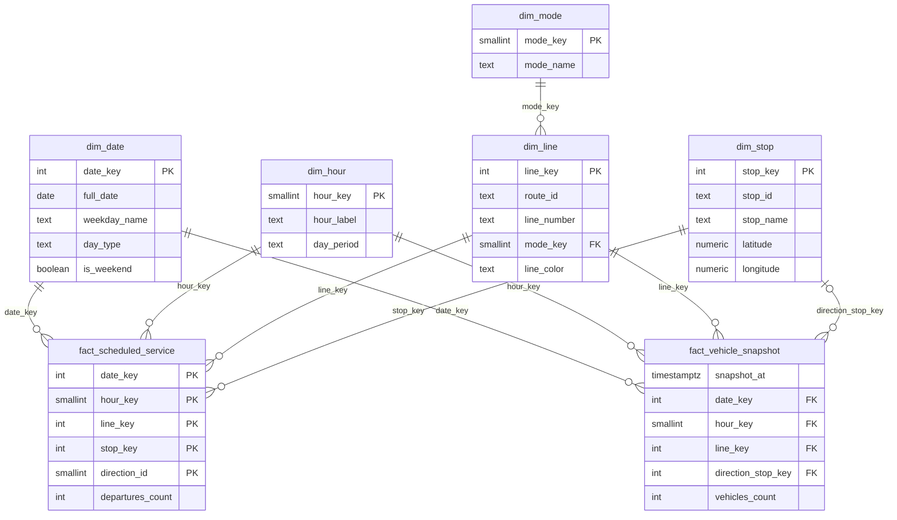

# Database schema

PostgreSQL database `brussels_mobility`, organised in two schemas.

| Schema    | Role |
|-----------|------|
| `staging` | Raw STIB data, loaded as-is (all columns `TEXT`, real-time responses kept as `JSONB`). |
| `dwh`     | Cleaned star schema, read by Power BI. |

## Data flow

```
GTFS zip (daily)        ─┐
                         ├─►  staging.*  ──(SQL transform)──►  dwh.dim_* / dwh.fact_*  ──►  Power BI
Vehicle Positions API  ──┘
```

## Star schema (`dwh`)



## Fact tables

| Table | Source | Grain | Measure |
|-------|--------|-------|---------|
| `fact_scheduled_service` | GTFS timetable | date × hour × line × stop × direction | `departures_count` (planned departures) |
| `fact_vehicle_snapshot` | Real-time API | snapshot × line × direction | `vehicles_count` (vehicles actually running) |

The two facts share the same dimensions, so the report can compare **planned service** with **vehicles actually on the network** for the same line and hour.

## Design choices

- **Hourly aggregation** for the timetable: one row per departure would produce tens of millions of rows per month, too heavy for Power BI in Import mode.
- **Surrogate keys** (`*_key`) for joins, STIB identifiers kept as natural keys with a `UNIQUE` constraint.
- **Times after midnight**: GTFS allows times like `25:10:00` for night services. They are moved to the next calendar day during the transformation, so `hour_key` stays between 0 and 23.
- **Raw JSON kept** in `staging.vehicle_positions_raw`: the API format can be re-parsed later without collecting again.

## Build the database

```bash
createdb brussels_mobility
cd sql
psql -d brussels_mobility -f 00_run_all.sql
```

Tested on PostgreSQL 16 (15+ required for `NULLS NOT DISTINCT`).